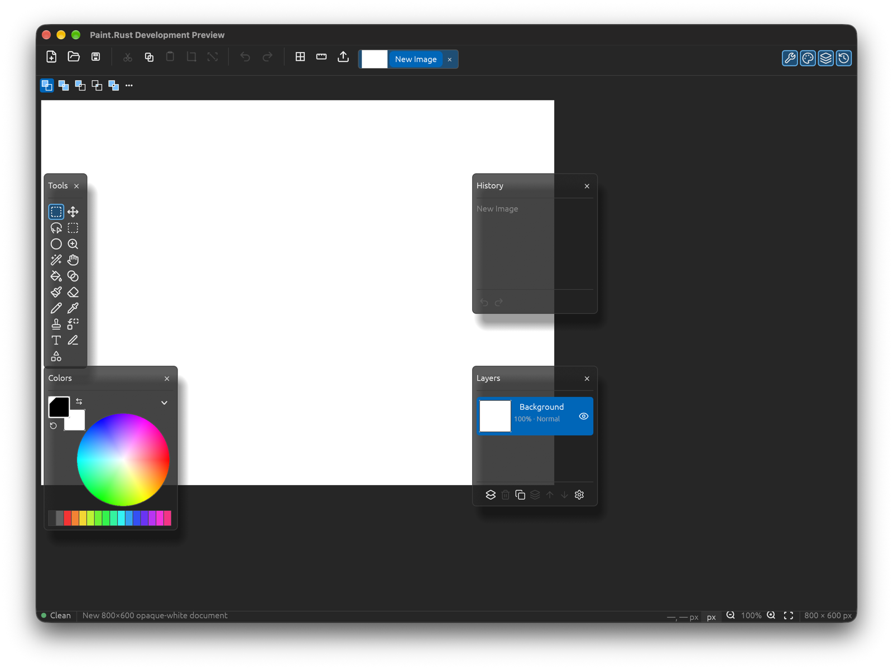

# Paint.Rust

A fast, modular image editor written in Rust, inspired by Paint.NET's direct, tool-first workflow.




Any help is appreciated! Comments, suggestions, issues, PRs! Give us a star to help!

> **Development preview:** Paint.Rust is early. There are no installers or public binaries yet;
> build it from source. Save As supports layered PDN (experimental interoperability) and flat
> PNG/JPEG/TIFF/BMP/TGA/DDS/GIF/WebP. Opening is currently limited to PNG. Paint.Rust is an
> original project, not affiliated with or endorsed by Paint.NET, and it does not use Paint.NET
> code or assets.

## Goals

Paint.Rust aims to be a native, fast and predictable raster editor with a familiar tool-first
workflow. The project treats [Paint.NET](https://www.getpaint.net/) as a behavioral and layout
reference while keeping its own implementation, assets and design.

The main goals are:

- A responsive native desktop editor with a small, understandable codebase.
- Real, tested tools instead of placeholder controls.
- A deterministic raster core that can be exercised headlessly.
- A modular workspace where the UI, document model, raster engine and I/O evolve independently.
- Honest parity: implemented behavior is demonstrated by tests; gaps are documented instead of hidden.
- Cross-platform foundations, with macOS as the first native-verified target.

## Current status

- **587 workspace tests** passing.
- Strict `clippy -D warnings`, formatting and `xtask verify` gates passing.
- Native macOS keyboard, focus, dirty-close and screenshot gate passing.
- macOS Apple Silicon is the only platform currently covered by the native window/input gate.
  Windows and Linux build paths are intended, but are not yet release-gated.
- No hosted CI, installer, notarized binary or public release yet.

## Features

- Multi-document tabs with per-tab paths, dirty markers, close guard, PNG Open and
  format-aware Save/Save As/Export.
- All 19 Paint.NET-ordered tools: Rectangle/Ellipse/Lasso/Magic Wand selection, Move Selected
  Pixels, Move Selection, Zoom, Pan, Paint Bucket, Gradient, Paintbrush, Eraser, Pencil,
  Color Picker, Clone Stamp, Recolor, Text, Line/Curve and Shapes.
- Mask-backed selections with Replace/Union/Subtract/Intersect/Xor and marching ants along
  the real mask boundary.
- Live previews for brush, eraser, clone, gradient, shapes, line, text, recolor and fill.
- Inline text editing on the canvas with caret, Enter to place, Shift+Enter for a new line and
  Escape to cancel.
- Move resampling modes for floating pixels and whole layers: nearest, bilinear, multisample
  bilinear and bicubic.
- Correct layer operations: add, delete, duplicate, merge, reorder, rename, visibility,
  opacity, Normal/Multiply/Screen/Overlay blending and Flatten.
- Crop to Selection, Resize, Canvas Size, rotations and flips.
- Clipboard Cut/Copy/Paste, Paste Into New Layer/Image, Select All, Invert, Erase and Fill
  Selection.
- Effects and adjustments including Invert, Grayscale, Sepia, Gaussian/Motion Blur, Sharpen,
  Add Noise, Brightness/Contrast, Hue/Saturation, Auto-Level, Levels, Posterize, Black and
  White and Threshold.
- Compact Paint.NET-style main toolbar and per-tool ToolConfigStrip, icon menus with shortcut
  hints, Colors/Layers/History panels, grid, rulers, units and zoom.
- Deterministic headless command traces and PNG snapshots for automated verification.

### Save formats

| Format | Status | Notes |
|---|---|---|
| PDN | Save | Layered document; Paint.NET interoperability is experimental |
| PNG | Save | Lossless RGBA, bounded encoder |
| JPEG | Save | Quality 90, alpha flattened over white |
| TIFF | Save | RGBA |
| BMP | Save | RGBA BMP |
| TGA | Save | RLE-capable RGBA |
| DDS | Save | Uncompressed BGRA |
| GIF | Save | Static single-frame GIF |
| WebP | Save | Lossless VP8L |
| AVIF, HEIC, JPEG XL, JPEG XR | Not yet | External/native codecs are not bundled |

Opening currently accepts PNG only. PDN files can be saved but not reopened by this preview.

## How should I use it?

Paint.Rust is built from source during the preview phase.

### Prerequisites

- [Rust](https://rustup.rs) with the pinned **1.95.0** toolchain (`rust-toolchain.toml`).
- A native graphics environment supported by `eframe`/`egui`.
- Python 3.12+ only if you want to run the packaging and native-gate tooling.

### Build and run

```sh
git clone https://github.com/diegomgarcia/paint-rust.git
cd paint-rust

# Uses the pinned Rust toolchain and locked dependencies.
./tools/cargo-pinned.sh run --release -p paint-ui --locked
```

If you prefer calling Cargo directly:

```sh
rustup toolchain install 1.95.0
cargo +1.95.0 run --release -p paint-ui --locked
```

The binary is written to `target/release/paint-ui`.

### First steps

1. Start with a new image or open a PNG.
2. Pick a tool from the Tools panel or use its shortcut (`S` cycles selection tools,
   `M` cycles move tools, `B` brush, `E` eraser, `T` text, and so on).
3. Configure the active tool in the compact strip below the main toolbar.
4. Manage colors, layers and history in the floating panels.
5. Use `Cmd/Ctrl+S` to save, `Cmd/Ctrl+C/V` for clipboard actions and `Cmd/Ctrl+Plus`,
   `Cmd/Ctrl+Minus`, `Cmd/Ctrl+0` to zoom only the canvas.

### Keyboard shortcuts

| Action | macOS | Windows/Linux |
|---|---|---|
| New image | `Cmd+N` | `Ctrl+N` |
| Open | `Cmd+O` | `Ctrl+O` |
| Save / Save As | `Cmd+S` / `Cmd+Shift+S` | `Ctrl+S` / `Ctrl+Shift+S` |
| Undo / Redo | `Cmd+Z` / `Cmd+Shift+Z` | `Ctrl+Z` / `Ctrl+Shift+Z` |
| Copy / Cut / Paste | `Cmd+C` / `Cmd+X` / `Cmd+V` | `Ctrl+C` / `Ctrl+X` / `Ctrl+V` |
| Select All / Deselect | `Cmd+A` / `Cmd+D` | `Ctrl+A` / `Ctrl+D` |
| Canvas zoom in/out/reset | `Cmd++` / `Cmd+-` / `Cmd+0` | `Ctrl++` / `Ctrl+-` / `Ctrl+0` |
| Finish floating move/text | `Enter` | `Enter` |
| Cancel preview | `Esc` | `Esc` |

## Verification

```sh
# Formatting, strict clippy, workspace tests, metadata and stub scan.
./tools/cargo-pinned.sh run -p xtask --locked -- verify

# Individual gates.
./tools/cargo-pinned.sh test --workspace --all-features --locked
./tools/cargo-pinned.sh clippy --workspace --all-targets --all-features --locked -- -D warnings
```

On macOS, the native usability gate builds the release app and checks real window focus,
keyboard input, dirty-close protection and screenshots:

```sh
./tools/cargo-pinned.sh build --release -p paint-ui --locked
python3 tools/macos_native_usability_gate.py target/release/paint-ui \
  --output-dir artifacts/native-gate
```

It requires macOS Accessibility and Screen Recording permissions for the terminal running it.

## Project layout

| Crate / directory | Responsibility |
|---|---|
| `crates/core` | Geometry, pixels, surfaces and shared errors |
| `crates/document` | Layers, selections, revisions and validated document patches |
| `crates/raster` | Deterministic CPU raster patches and layer composition |
| `crates/image-io` | Bounded PNG decode plus multi-format encode and atomic output |
| `crates/pdn3` | Bounded, versioned PDN3 semantic codec |
| `crates/app` | Application session, command traces and undo/redo |
| `crates/ui` | Native `eframe`/`egui` desktop UI |
| `crates/plugin-bridge` | Versioned IPC and lifecycle for isolated plugin hosts |
| `plugin-host` | Isolated plugin-host development lane |
| `tools` | Verification, packaging and native-gate tooling |

See [the implementation plan](docs/IMPLEMENTATION_PLAN.md),
[UI parity notes](docs/reference/UI_PARITY_DIFF.md) and
[release status](docs/RELEASE_STATUS.md) for deeper details.

## Known issues and limitations

1. **PDN open is not implemented.** Layered PDN save works, but this preview cannot reopen
   PDN files yet; flat formats intentionally store only composed pixels.
2. **AVIF, HEIC, JPEG XL and JPEG XR are not available.** They require native/external codecs
   that are not bundled.
3. **No public installer or binary.** The preview builds from source; distribution still needs
   signing, notarization, legal clearance and hosted CI.
4. **Advanced effects are incomplete.** Curves, Exposure, Highlights/Shadows, Invert Alpha,
   Temperature and Tint are intentionally disabled rather than faked.
5. **Move has no scale/rotation handles.** It supports translation with subpixel resampling.
6. **Freeform shapes are not implemented.** The 19-tool strip reflects the supported subset.
7. **Not pixel-identical to Paint.NET.** Layout and behavior are reference-driven, but exact
   rendering parity is not claimed.
8. **Windows/Linux are not release-gated.** Builds are intended, but macOS is the only platform
   with a native window/input gate today.
9. **No Paint.NET plugin compatibility.** The isolated plugin lane is a separate, incomplete
   development path; Paint.NET binaries are not loaded.

## Roadmap

- PDN open/load and broader interoperability tests against stock Paint.NET.
- Complete the remaining adjustments and effects with previews and undo.
- Move scale/rotation handles and Freeform shapes.
- Windows/Linux native gates and hosted three-OS CI.
- Packaging, code signing, notarization and third-party notice completion.
- Harden and document the isolated plugin host.
- Broaden reference-driven visual and behavioral parity.

## Contributing

Issues, suggestions and pull requests are welcome. For code changes:

1. Keep changes TDD-first and include tests that demonstrate real behavior.
2. Do not add fake controls or unimplemented menu entries.
3. Do not copy Paint.NET code, icons, bitmaps or other proprietary assets.
4. Keep `references/` read-only; it is local reference material and is not distributed.
5. Run `./tools/cargo-pinned.sh run -p xtask --locked -- verify` before opening a PR.

Please open an issue before starting a large feature so the approach can be discussed first.

## Support this project's author ([@diegomgarcia](https://github.com/diegomgarcia)) with Patreon

[](https://www.patreon.com/dmgarcia)

Or make a single donation buying me a coffee:

[](https://www.buymeacoffee.com/dmgarcia)

You can also show support by linking to this repository from your project.

## License

Paint.Rust is licensed under the [MIT License](LICENSE).

Paint.NET is a trademark of its respective owner. Paint.Rust is an independent project and is
not affiliated with, endorsed by or sponsored by Paint.NET or its maintainers. Third-party
dependencies and assets retain their own licenses; see the project notices and
[release status](docs/RELEASE_STATUS.md) before redistributing binaries.
